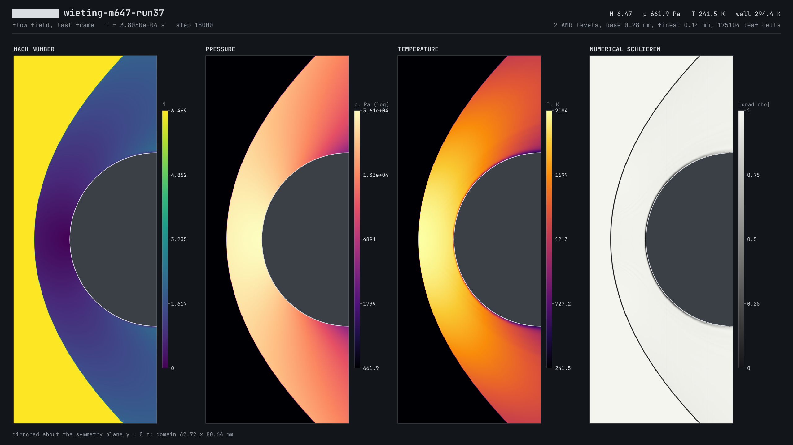
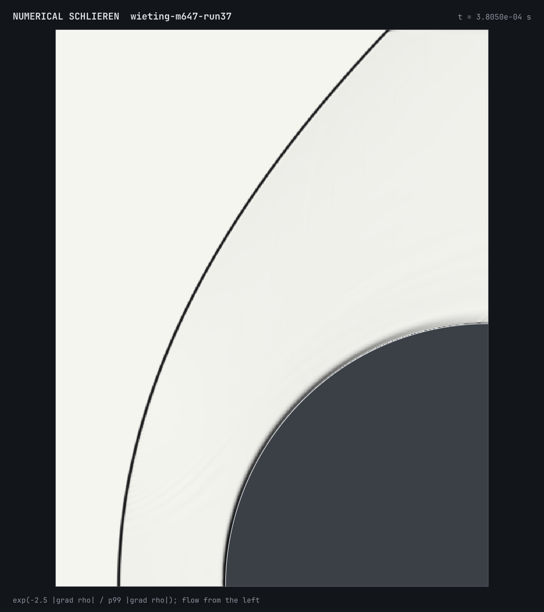
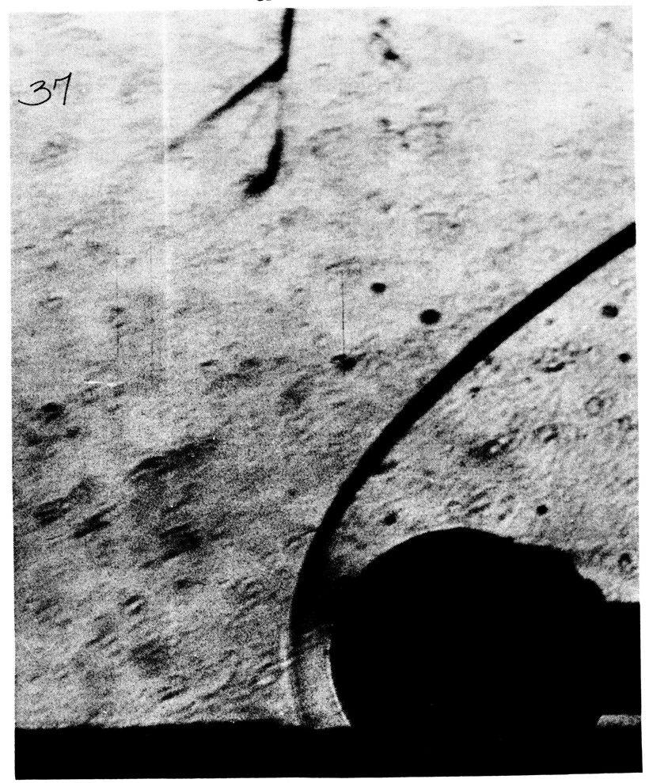
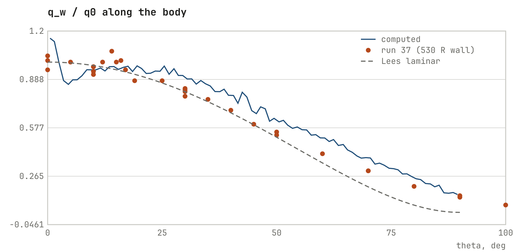
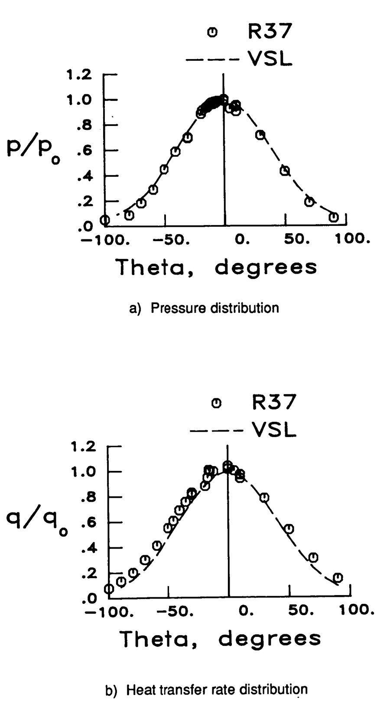

# Hypersonic CFD validation: Mach 6.47 cylinder (NASA TM-100484, run 37)

A validation run of my GPU hypersonic CFD solver against a classic NASA
wind-tunnel test: **A. R. Wieting, NASA TM-100484 (1987), 8-ft High
Temperature Tunnel, run 37**, a 3-inch cylinder in Mach 6.47 flow. The report
is a U.S. Government work in the public domain; its appendix tabulates the
measured surface pressure and heat transfer around the cylinder.

The full report is in [`report/report.pdf`](report/report.pdf) (also as
[`report/report.html`](report/report.html)). All figures are separate PNGs in
[`report/`](report/).

## The test in everyday units

| | |
|---|---|
| Flow speed | **2.0 km/s ≈ 7,260 km/h** (Mach 6.47) |
| Free-stream air | **−32 °C**, 662 Pa (about the air at ~34 km altitude) |
| Gas in front of the nose | heats up to **~1,900–2,000 °C** |
| Cylinder | **76 mm** diameter, wall held at **21 °C** |
| Measured nose heating | **670 kW/m² = 67 W/cm²** |
| Bow shock | stands about **15 mm** ahead of the cylinder |

## What was simulated

- 2D laminar Navier–Stokes, half domain with a symmetry plane
- 5-species air, finite-rate chemistry, two-temperature (vibrational) nonequilibrium
- Composition-dependent transport (Chapman–Enskog), Stefan–Maxwell diffusion
- Cut-cell (immersed boundary) wall, isothermal at 294.4 K
- Adaptive mesh refinement, 2 levels: 0.28 mm base, 0.14 mm at the wall and the shock
- 18,000 steps to 3.8×10⁻⁴ s of flow time (steady: wall heat changed 0.4 % over the last 10 %)
- **2 h 40 min on a laptop RTX 3050 Ti (4 GB)**

## Results

| Quantity | Simulation | Reference | Difference |
|---|---|---|---|
| Pitot (stagnation) pressure | 36.12 kPa | 36.06 kPa (5.23 psia, measured) | **+0.17 %** |
| Surface pressure P/Po | — | run 37 pressure taps | RMS 0.040, within gauge scatter |
| Shock standoff distance | 15.5 mm | 16.4 mm (Billig correlation) | −5.7 % (expected: real gas compresses more) |
| Shock shape | — | schlieren photo, Fig. 17 | matches visually |
| Stagnation heat flux | 543 kW/m² | 670 kW/m² (measured) | **−19 %** |
| Heat-flux distribution q/q0 | — | run 37 heat gauges | RMS 0.086 (tolerance 0.08) |

| Computed schlieren | Wind-tunnel schlieren (Fig. 17) |
|---|---|
|  |  |

| Computed q/q0 along the body | Measured p/Po and q/qo (Fig. 18) |
|---|---|
|  |  |

## Accuracy and the heat-flux problem

Gas dynamics are good: shock position, shock shape and surface pressure fall
within the experimental scatter.

Heat flux is the weak spot. Wall heating comes from the temperature gradient at
the wall, and near the stagnation point the thermal boundary layer is only
about **0.5 mm thick**. A 0.14 mm Cartesian grid puts just 3–4 cells across
it, so the computed heating is about 19 % low. It also wobbles by about ±15 %
along the surface where the curved wall crosses from one grid column to the
next, a known weakness of cut-cell walls. Codes built for aeroheating use
thin body-fitted cells at the wall for this reason.

At this speed the physics models are not the bottleneck: there is almost no
dissociation at ~2,000 °C. The limit is wall resolution. The next step is a
grid-convergence run with a third refinement level at 0.07 mm in the wall band.
Even a perfect simulation has a floor here: the tunnel ran on methane–air
combustion products, and its heat gauges scatter about ±5 % at the
stagnation point.

## Source

A. R. Wieting, *Experimental Study of Shock Wave Interference Heating on a
Cylindrical Leading Edge*, NASA TM-100484, May 1987.
Figures marked `ref_*` are cropped from that report.
